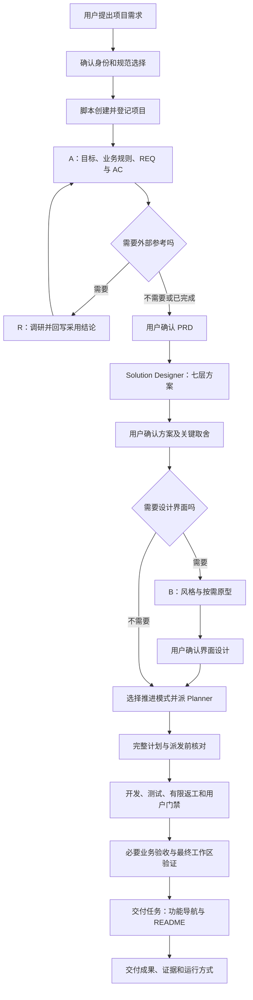

# 01 整体架构与执行总览

[阅读目录](README.md) · [下一篇：新项目完整流程](02-new-project.md)

## 1. 这套 SDD 管理什么

这里的 SDD 可以理解为“先形成明确规格，再让实现和验收围绕规格推进”。它把这个思想落实到多项目、多智能体和可恢复的文件记录中。

| 问题 | 主要机制 |
| --- | --- |
| 这次做哪个项目、做什么 | Router、项目管理、登记、PRD |
| 如何实现、怎样表现给用户 | 七层方案、体验决策、UI 风格与原型 |
| 谁先做、谁并行、完成交给谁 | Planner、tasks.json、主智能体、派发检查脚本 |
| 怎样证明完成、失败怎样恢复 | AC、自验、独立测试、用户门禁、经验记录 |

主智能体既是沟通入口，也是执行期间的编排器。它沿规则选择阶段，调用当前平台真实提供的子智能体工具，收集结果，再更新记录。目录本身不会自动启动这些工作。

## 2. 六层结构

| 层次 | 位置 | 用途 |
| --- | --- | --- |
| 平台入口 | AGENTS.md、.agents、.codex、.claude、.cursor | 让不同客户端找到同一套规则和角色 |
| 流程与角色 | harness-core 中的 router、skills、agents、protocols | 定义步骤、职责与继续条件 |
| 可选规范 | harness-core/specification | 选定技术栈的代码、接口、环境和测试约定 |
| 项目事实 | project-registry.json、Projects_Repo | 各项目的身份、设计、任务、代码和证据 |
| 工具模板 | scripts、templates | 创建项目、检查依赖和门禁、提供结构 |
| 配套能力 | pycore、learning、memory | 后端模块、技术词汇学习、已验证经验 |

流程规则说明“如何开展工作”；项目文件保存“这个项目的事实和成果”；PyCore 是业务程序可使用的代码库。

## 3. 新项目主线

此图表示阶段条件，不表示所有代码必须串行。自动模式允许按真实依赖并行前端和独立后端，详见 [04](04-execution-and-gates.md)。

## 4. 区分三条流程

设计链决定产品与实现承诺：A → 七层技术方案 → 必要的 B。R 是 A 中的按需调研分支，字母顺序不是执行顺序。

开发链决定如何实现与验证承诺：Planner → Developer → Tester → 通过或返工。每项结果返回后，主智能体根据依赖、门禁和实际资源决定下一任务。

业务程序运行链则是用户使用已开发软件时如何处理请求。PyCore 的 Flow、Service、AgentService 属于这一层，不负责启动本框架的 Planner/Developer/Tester。

## 5. 为什么分开 PRD、方案和任务

“上传文件后拿到转换结果”是用户目标；“采用上传接口与转换模块”是方案；“上传页 Mock、转换后端、完整链路验收”是任务安排。

分开后，改布局可以只调界面设计，更换内部算法可以只更新相关方案，用户结果改变才回到需求与 AC。任务依然追踪需求，防止只完成技术模块却不能使用。

## 6. 如何知道当前做到哪一步

项目身份看 `.sdd/project.json`；设计确认看文档状态及真实确认记录；开发进度看 `.sdd/tasks.json`；实际运行的子智能体看平台调用记录。

`in_progress` 不保证智能体还活着；角色配置存在不保证平台已加载；Confirmed 必须有真实确认依据。继续时需要核对事实，不能只看字段。

在客户端打开框架根目录后，可以用自然语言表达项目意图，无需手动依次点击全部 Skill。原文要求执行时只读当前阶段所需资料；此次是明确的框架分析请求，才阅读整体流程。

依据：[Router](../Develop_Helper/harness-core/router.md)、[平台适配](../Develop_Helper/harness-core/protocols/platform-adapters.md)、[开发循环](../Develop_Helper/harness-core/protocols/development-loop.md)、[PyCore 入口](../Develop_Helper/pycore/docs/index.md)。
