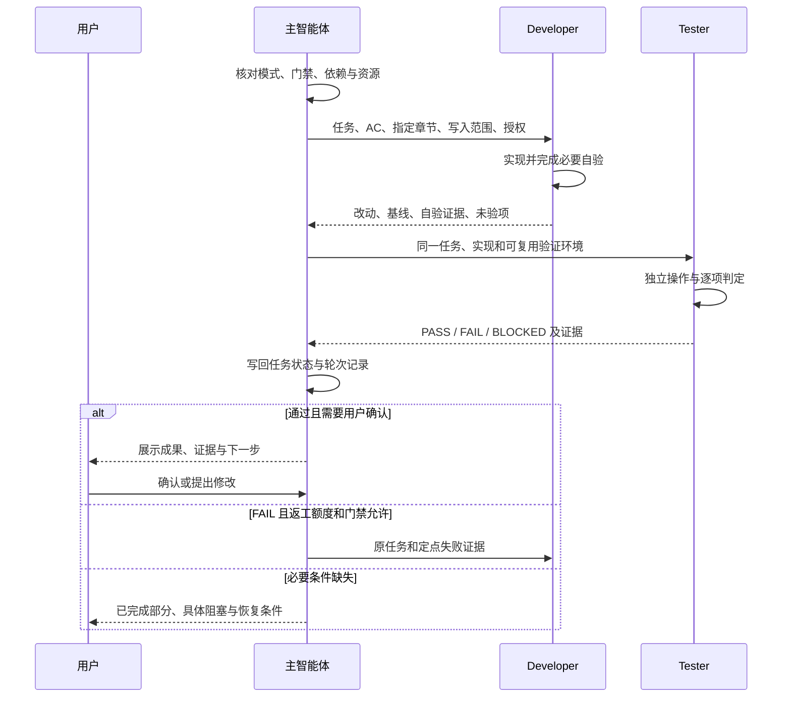

# 03 角色、文件与追踪关系

[阅读目录](README.md) · [上一篇](02-new-project.md) · [下一篇：调度与门禁](04-execution-and-gates.md)

## 1. 一位主智能体，四种执行角色

| 角色 | 什么时候介入 | 主要输入 | 输出与职责边界 |
| --- | --- | --- | --- |
| 主智能体 / 编排器 | 全流程 | 用户请求、项目身份、阶段成果和真实运行状态 | 需求沟通、重要决定转达、派发、收集证据；唯一维护任务执行状态和项目经验 |
| Solution Designer | PRD 确认后进入技术方案 | PRD、规范选择、设计范围、允许改动文档 | 技术方案、待决问题、必要决策记录；不拆 Feature/Task，不写业务代码 |
| Planner | 方案和必要界面确认后 | PRD、tech-spec、相关设计、推进模式 | 首次生成 tasks.json；后续仅提出受影响任务调整，不改业务代码 |
| Developer | 任务依赖和门禁允许 | 当前任务、指定章节、规范、写入范围、失败证据 | 当前任务代码和必要自验、改动清单、未验项；不宣布最终独立验收通过 |
| Tester | 实现具备可验证成果后 | 同一任务、实现基线、开发证据、可用环境 | 独立 PASS/FAIL/BLOCKED 与逐项证据；不改业务实现、AC 和任务状态 |

主智能体在产品设计阶段承担用户对齐；B 阶段调用 UI 设计 Skill，但没有单独定义一个必须新建的 UI 子智能体角色。

首次方案和首次任务规划要求实际派发角色。读取角色文件不等于启动角色。实际平台不能调度时，才按协议明确降级，由主会话按角色顺序执行，并说明测试是否由同一会话完成。

## 2. 一项任务怎样交接

Developer 和 Tester 使用同一套 AC，但各自给出自己的证据。测试可以复用同版本构建结果和可用工具，用户行为仍须独立验证。

## 3. 哪个文件记录哪种事实

下表中以 docs 或 .sdd 开头的路径均指具体业务项目内，除非另有说明。

| 文件 | 回答的问题 | 产生与维护时机 |
| --- | --- | --- |
| 根 project-registry.json | 有哪些项目、默认活动项目是谁 | 项目创建、纳管、切换、移除时维护 |
| .sdd/project.json | 这个项目是谁、类型和所选规范是什么 | 创建/纳管建立；specification 的唯一权威 |
| docs/PRD.md | 用户要什么、范围是什么、怎样验收 | A 形成；需求改变时更新受影响部分 |
| docs/tech-spec.md | 如何实现接口、数据、模型、算法、异常和配置 | Solution Designer 形成；技术约定改变时更新 |
| docs/decisions.md | 为什么选择某种重要体验方案 | 有实质取舍才创建，保留选择及确认依据 |
| docs/ui-style.md | 本项目页面如何呈现 | B 中 UI Skill 形成，有界面才需要 |
| docs/prototypes/ | 设计可以怎样实际操作 | 有必要或用户要求时创建，不强制 |
| .sdd/tasks.json | 怎么拆任务、依赖谁、处于什么状态 | 首次 Planner 生成；执行状态仅编排器维护 |
| .sdd/work-log.md | 关键进展、用户确认、阻塞、无任务 Bug 摘要 | 需要跨轮记录时维护，不另存任务清单 |
| .sdd/test-reports/ | 较长的验收证据 | 证据较长或复验需要才保存 |
| .sdd/bug_fix/ | 复杂独立 Bug 的长证据 | 复杂问题按需保存，不每次必建报告 |
| .sdd/experience.md | 哪些已复验修复值得下次使用 | 编排器去重写入；开发和测试仅提建议 |
| docs/project-console.html | 实际页面/入口有什么功能、背后如何实现 | 每轮完整计划最后的 delivery 任务 |
| docs/project-map.json | 功能导航可使用的结构化说明 | 可选实现，不是强制状态库 |
| 项目 README.md | 怎样配置、启动、验证、打开和刷新导航 | 按实际交付更新 |
| .sdd/status.json | 初始化阶段摘要 | 当前脚本会创建；不能据此取代任务真实进度 |

status.json 中虽有 current_task 等字段，当前流程明确要求 tasks.json 是唯一任务状态来源。项目登记中的 initialized 也不自动证明当前开发阶段，见 [原文与脚本差异](07-source-map-and-notes.md)。

## 4. 编号之间怎样关联

| 编号 | 意义 | 定义位置 | 例子（假设） |
| --- | --- | --- | --- |
| REQ-001 | 用户需求 | PRD | 上传文档并取得转换结果 |
| AC-001 | 可观察验收标准 | PRD 的所属需求下 | 合规文件转换后能取得正文 |
| API-001 | 接口身份 | tech-spec | 上传与转换接口 |
| D-001 | 重要决策 | decisions | 超时后怎样保留或清理结果 |
| F-001 | 可交付用户能力 | tasks 顶层 features | 文件转换能力 |
| T-001 | 一项实现或验收阶段工作 | tasks 内 tasks 数组 | 上传与结果页面 Mock |
| DEL-001 | 框架规定的导航交付验收 | 交付协议 | 导航与功能卡片正常使用 |

追踪关系是：任务的 source_feature 指向 Feature；Feature 的 source_requirements 指向 PRD 需求；任务的 acceptanceCriteria 引用 AC；技术方案的 API 关联相应 REQ/AC。

一个需求可以由多个 Feature 承接，一个 Feature 可拆多个任务。前端、后端、联调是任务类型，不代表必须是三个独立用户能力。

前端 Mock 任务可以没有独立业务 AC，但必须有明确 technicalChecks，并指定真实 AC 由哪个后续任务完成。不能把“接口真的处理成功”的 AC 改写成“Mock 返回成功”。

框架导航使用 F-DELIVERY → SDD-DELIVERY → DEL-001～005，是明确的来源例外，不伪造 PRD 业务需求。旧项目沿用原编号和记录，不强制迁移。

## 5. 任务的最小上下文是什么

| 字段 | 放什么 | 如何定位 |
| --- | --- | --- |
| source_files | PRD、tech-spec 和实际存在的设计入口 | 项目相对路径 |
| context_files | 当前任务所需的业务、技术、设计、决策章节 | 项目相对 path + 精确 section |
| rules_files | 项目选定规范集中的适用工程规则 | 相对 harness-core，必须属于所选集 |
| write_scope | 允许修改的文件或目录 | 项目相对路径，派发前明确归属 |

例如，上传页任务应读 PRD 的上传需求、API-001 的请求响应、上传页设计章节，而不是重读全项目需求访谈。涉及模型行为时不能仅给输出类型，还要给决定结果的提示词和规则。

UI 风格是项目设计，放 context_files；它不属于 rules_files，因此 specification 为 null 的项目仍可以有完整 UI 设计。

## 6. 并行时谁能改什么

编排器是 tasks.json 的单一执行状态写入者。Developer 只改分配范围，Tester 验证时不修改业务实现；Planner 对已执行计划提出调整，由编排器应用并保留历史。

共享类型、API client、依赖锁文件、路由注册、配置必须明确唯一写入者。独立窗口或 worktree 不自动消除最终文件冲突；Tester 正在检查的实现基线也不能同时被另一任务改动。

依据：[角色定义目录](../Develop_Helper/harness-core/agents/)、[Planner](../Develop_Helper/harness-core/agents/planner.md)、[任务模板](../Develop_Helper/templates/tasks.json)、[开发循环](../Develop_Helper/harness-core/protocols/development-loop.md)、[子智能体协议](../Develop_Helper/harness-core/protocols/codex-subagents.md)。
