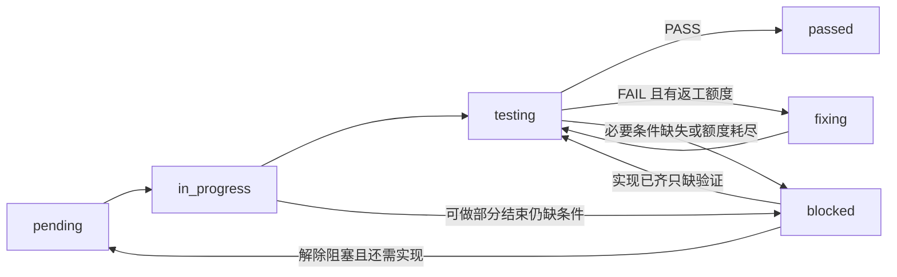
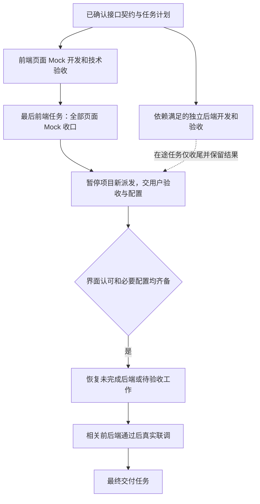

# 04 开发调度与验收门禁

[阅读目录](README.md) · [上一篇](03-roles-and-artifacts.md) · [下一篇：修改与恢复](05-existing-projects.md)

## 1. 从任务图到实际执行

Planner 产出任务依赖图；主智能体读取当前模式与状态，调用 sdd_dispatch.py，拿到当前允许的候选，再核对真实智能体、文件和资源占用，最后实际派发。

检查脚本只读取一个 tasks.json，输出 developer_ready、tester_ready、gate_phase、step_phase 等信息。它不启动智能体、不更新任务、不验证确认摘要是否来自真实用户，也不检查所有源码、AC 语义和授权。

因此“脚本列出候选”仅表示通过它实现的结构与门禁条件。可用名额、写入范围、外部授权、环境和版本仍由编排器检查。

示例命令（路径替换为真实项目）：

```bash
python3 scripts/sdd_dispatch.py --tasks Projects_Repo/file-helper/.sdd/tasks.json
```

有实际运行任务时使用重复的 `--running-task T-001` 参数传入，ID 去重。尤其 Tester 运行时任务仍是 testing，不能把它误当待派发，启动第二次。

## 2. 两种推进模式

| 行为 | automatic | step_by_step |
| --- | --- | --- |
| 当前能推进多少任务 | 按依赖、名额和冲突允许多个 | 一次一个当前任务 |
| 同任务 Developer → Tester → 返工 | 在允许范围内连续进行 | 同样连续，不逐角色征求确认 |
| 普通任务 Tester PASS 后 | 自动寻找下一就绪任务 | 展示成果，等用户确认后再继续 |
| 前端 Mock 用户门禁 | 必须遵守 | 必须遵守 |
| 最终 delivery 任务 | 完成验收后交付 | PASS 后仍须用户确认 |
| 自动提交或发布 | 模式不授予 Git/发布权限 | 同左 |

新计划的模式需用户选择，模板的 step_by_step 仅为示例。旧计划缺 execution_mode 时，脚本兼容 automatic；存在字段但值非法会阻止派发。

优先级影响就绪任务的先选顺序，依赖决定任务能否开始；T-编号本身不表示串行顺序。逐步模式也不应靠制造虚假依赖来实现串行。

## 3. 任务状态与判定结果

| 状态 | 含义 | 下一步 |
| --- | --- | --- |
| pending | 等待实施且尚未派发 | 条件满足后交 Developer |
| in_progress | 已实际派发开发 | 回收实现和证据 |
| testing | 等待或正在验收 | 核对实际实例后交 Tester 或等待返回 |
| fixing | 已判定缺陷、处于返工流程 | 按失败项修复，再测试 |
| passed | 当前任务的必要检查已经通过 | 再判断用户门禁、Feature AC 和后续依赖 |
| blocked | 必要条件缺失或自动返工耗尽 | 明确恢复条件后复用原任务 |



FAIL 是 Tester 的判定结果，不是独立任务状态。一般由编排器转换为 fixing，额度耗尽时转 blocked。

PASS 要求当前任务全部必要 AC/技术检查有实际证据；FAIL 是已经证实不符；BLOCKED 是无法完成必要验证。部分通过不能包装为整体通过；同时有失败和阻塞时保留两类事实，优先报告已证实 FAIL。

## 4. 四类不同的确认

| 确认 | 对象 | 记录/位置 | 不能被什么替代 |
| --- | --- | --- | --- |
| 设计确认 | PRD、技术方案、必要 UI 设计 | 文档状态与真实会话/记录 | 文件存在或 AI 自行标 Confirmed |
| 开发意图与模式选择 | 是否开始开发、用何种节奏 | 会话授权、execution_mode | 只要求规划或模板示例 |
| 逐步任务确认 | 当前任务实际成果 | 顶层 step_gate | Tester PASS 本身 |
| 前端 Mock 与配置确认 | 整体 Mock 可接受且必要服务配置就绪 | 最后前端任务 user_gate | 原型确认、初始授权、只填 Key 或只认可界面 |

其中 step_gate 和 user_gate 都有 pending、awaiting_user、changes_requested、passed，但作用不同：前者是当前任务检查点，后者是整体前端到真实联调的项目门禁。

## 5. 前端优先与真正的并行关系



后端未完成的工作可在门禁放行后继续；后端此前已经完成的结果直接复用。此图中的“恢复”不要求重复开发。

前端优先表示先选择已就绪前端任务，不要求所有后端等前端完工。最后前端任务必须依赖其余全部前端任务，可以通过传递依赖实现，不能只用较低优先级假装它最后执行。

## 6. 前端门禁的逐步行为

1. 前端进行中：脚本允许前端和独立后端候选；integration/delivery 不放行。
2. 全部前端通过：设置 awaiting_user，立即停止新的 Developer、Tester、返工和联调派发。即使尚未来得及更新门禁状态，脚本也会因全部前端 passed 而暂停。
3. 在途工作：已运行后端可完成当前范围。结果只保存，不能因为“刚好后端写完了”就立刻补派 Tester；收到 FAIL 也先记录。
4. 向用户交接：提供 Mock 地址/启动方式、页面和操作清单、已验/未验范围，以及需填写配置的文件位置和字段名。
5. 用户提出修改：进入 changes_requested，清空旧界面确认，仅允许 rework_task_ids 指定的前端修复和复验。跨页或共享前端修改要重新打开整体收口任务。
6. 用户认可且配置齐备：必要服务状态为 confirmed，并有界面确认、配置检查与真实调用授权范围记录，才置 passed；没有服务也要记录配置“不适用”。
7. 放行后：回收在途成果，复用原任务、证据、确认和重试计数，再继续真实联调。配置齐全本身不证明真实调用通过。

此门禁优先于普通“缺 Key 先做本地部分”的规则：等待用户时整个项目不补派，只能已有任务收尾或按用户要求修前端。

## 7. 测试失败、缺 Key 与返工额度

默认 max_retries=2 表示首次实现后最多两轮自动修复，不是总共只允许两次实现。编排器每次派修复前增加 retry_count。

例如：首次测试 FAIL → 修复第 1 轮 → 复验 FAIL → 修复第 2 轮 → 仍 FAIL，则 blocked，记录最后问题和尝试，不自动清零继续。

缺 Key、服务权限、必要环境不是代码缺陷。门禁允许时先完成已授权的本地实现和局部验证，再对剩余真实 AC 标 blocked。不能把 Mock 或 fallback 当原 AC 的真实通过，也不能用“缺 Key”掩盖已证实的本地缺陷。

只有条件实际改变才恢复 blocked：还需编码回 pending，代码已齐只缺验证回 testing。自动返工额度扩大需明确决定；重新启动子智能体不重置次数。

## 8. 模式切换和暂停

自动切逐步：先收回真实在途状态，停止新派发，让现有任务收尾；脚本可返回 draining。保留一个当前检查点，其他成果按协议逐个验收并交用户，不强杀、不重复派发。

逐步切自动：可以解除普通逐任务等待，但不能取消已提出的修改要求，也不能绕过前端门禁。已要求返工的任务仍限定修复，直到明确认可或撤销要求。

用户暂停：保存状态并停止新派发；用户继续后核对原任务、证据和实例，按剩余工作恢复，而不是重建整个计划。

## 9. 怎样才算整个功能和项目完成

前端技术 PASS 只证明前端阶段；Feature 完成要看关联业务 AC 是否全部由指定任务真实验收；项目完成还要看最终工作区集成证据和 delivery 导航验收。

可复用同版本技术检查证据，不能用旧版本 PASS 证明新改动，也不能用接口 curl 代替要求完整页面操作的用户 AC。必要验证结束即可收敛，不机械反复全量测试。

依据：[开发循环](../Develop_Helper/harness-core/protocols/development-loop.md)、[模式协议](../Develop_Helper/harness-core/protocols/execution-mode.md)、[前端门禁](../Develop_Helper/harness-core/protocols/frontend-gate.md)、[Tester](../Develop_Helper/harness-core/agents/tester.md)、[派发脚本](../Develop_Helper/scripts/sdd_dispatch.py)。
