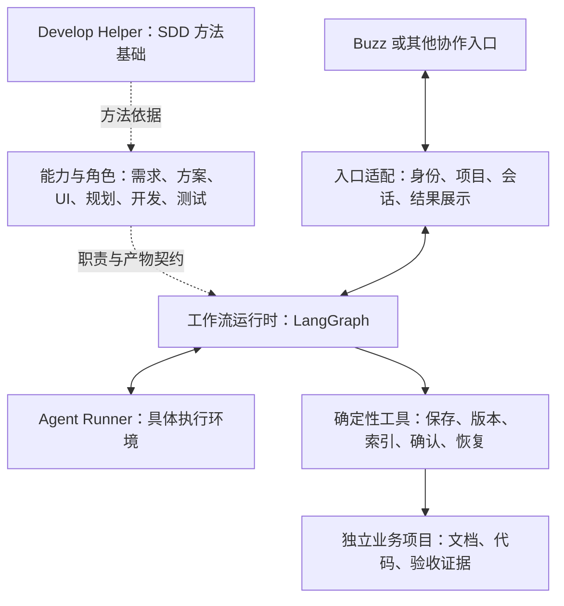

# SA-mate

> 已发布：底层 SDD 固定源码快照、中文阅读指南，以及融合架构、能力与角色设计。领域工具、Runtime 实现和 Buzz 接入资料继续分批整理；未上传的资料仍明确标注。

以 SDD 为方法基础，支持需求、方案和 UI 独立交付，并逐步衔接规划、开发与独立验收的智能体协作框架。

## High-level design



这张图展示各部分的职责关系。目标架构、已有实现、验证范围与生产接线分别说明，图中的角色和入口并非全部已经接通。

通用能力与确定性工具是独立的一块：角色形成候选内容，工具负责保存成果、校验版本、记录确认和事务恢复。

## 1. 底层 SDD：方法从哪里来

SA-mate 以 Develop Helper 的 SDD（规格驱动开发）方法为基础。本仓库已收录固定版本原框架与中文阅读指南，可从 [SDD 阅读入口](docs/sdd-foundation.md) 开始。

```text
目标
  → A：需求与验收（按需进入 R 调研，再返回 A）
  → 七层技术方案
  → 必要的 B：界面设计
  → Planner
  → Developer
  → Tester
  → 交付
```

| 内容 | 作用 | 原文入口 |
| --- | --- | --- |
| Skills | 每类工作怎样开展 | [方法目录](Develop_Helper/harness-core/skills/) |
| Agents | 执行角色的职责与边界 | [角色目录](Develop_Helper/harness-core/agents/) |
| Protocols | 调度、门禁、返工、恢复和交付 | [协议目录](Develop_Helper/harness-core/protocols/) |
| Templates／Scripts | 形成成果、检查条件的辅助工具 | [模板](Develop_Helper/templates/) · [脚本与测试](Develop_Helper/scripts/) |
| 可选规范／PyCore | 具体业务项目按需使用的工程资产 | [规范说明](Develop_Helper/harness-core/specification/README.md) · [PyCore 文档](Develop_Helper/pycore/docs/index.md) |

### 怎样阅读

1. **先理解全貌**：[中文阅读指南](Develop_Helper_reading-guide/README.md) → [整体流程](Develop_Helper_reading-guide/01-overview.md) → [从需求到交付的实例](Develop_Helper_reading-guide/06-walkthrough.md)。
2. **再查职责与门禁**：[角色、文件与追踪关系](Develop_Helper_reading-guide/03-roles-and-artifacts.md) → [执行与门禁](Develop_Helper_reading-guide/04-execution-and-gates.md)。
3. **核对原始规则**：[原文地图](Develop_Helper_reading-guide/07-source-map-and-notes.md) → 对应的 `Develop_Helper/harness-core/` 原文。

阅读指南帮助理解和定位，规则依据仍回到上游原文。PyCore 是可选业务基础库；SA-mate 的持久工作流由独立 Runtime 承担。

### 目录与版本

```text
Develop_Helper/                 固定提交的原框架源码
Develop_Helper_reading-guide/   8 篇中文导航与解释
docs/sdd-foundation.md         方法总览、目录地图与离线检查入口
docs/upstream.md               来源、版本、范围与更新方式
upstream/develop-helper-source.json 逐文件校验清单
```

本批采用普通源码快照，clone 后即含原文，无需初始化 submodule。上游固定提交为 `ec75f8f113402be73a415282dd274a8e3513f291`，共 169 个文件；项目登记与学习进度使用该提交的空白状态，不上传本机个人记录或业务项目。

[Develop Helper 原始说明](Develop_Helper/README.md) · [来源与快照说明](docs/upstream.md) · [第三方来源说明](THIRD_PARTY_NOTICES.md)

## 2. 融合拆解：哪些保留，哪些改变

SA-mate 将 SDD 方法按用途组织为可独立调用的能力，并分开用户协调、持久执行与确定性写入。详细说明从 [融合设计导航](fusion-design/README.md) 进入。

### 两条使用路线

- **独立交付**：只澄清需求、只输出方案、只制作 UI，都可以完成后结束；已有材料足够时直接复用。
- **工程衔接**：需要实现时，再补齐相关规格、用途确认、任务规划、开发和独立验收。

用户未要求继续时，本次交付可以结束。编号单元表示建设责任，不要求每次调用都走完全部流程。

### 三层职责

| 层次 | 负责什么 | 设计入口 |
| --- | --- | --- |
| 能力与规则 | 需求、方案、UI 的独立交付，以及按需工程衔接 | [00 总体拆解](fusion-design/00-拆解与融合框架.md) |
| 编排与确定性执行 | 角色与工具授权、持久状态、暂停恢复、版本校验和获授权写入 | [06 角色与工作流运行时](fusion-design/06-角色与工作流运行时.md) |
| 协作界面 | 用户交互、可信身份、消息、线程与结果展示 | [Main 用户入口与项目协调](fusion-design/Main-Agent-用户入口与项目协调.md) |

### 角色分工

| 角色 | 核心责任 | 详细说明 |
| --- | --- | --- |
| Main | 理解意图、协调项目与角色、展示成果、收集决定 | [Main 角色设计](fusion-design/Main-Agent-用户入口与项目协调.md) |
| 需求角色 | 澄清业务，形成需求或 PRD 候选 | [02 需求能力](fusion-design/02-需求能力.md) |
| Solution Designer | 形成方案与可追踪的技术契约 | [03 方案能力](fusion-design/03-方案能力.md) |
| UI 角色 | 页面、原型与演示验证 | [00 独立交付与角色方向](fusion-design/00-拆解与融合框架.md) |
| Planner | 工程输入就绪后拆分 Feature、Task 和依赖 | [上游 Planner](Develop_Helper/harness-core/agents/planner.md) |
| Developer | 在明确范围内实现并自验 | [上游 Developer](Develop_Helper/harness-core/agents/developer.md) |
| Tester／Verifier | 独立验证并返回证据 | [上游 Tester](Develop_Helper/harness-core/agents/tester.md) |

Runtime 单独列为执行组件。角色生成候选与证据，Runtime 和确定性工具负责获授权的状态推进与权威写入。保存、登记、确认、交接、消息发送和下游启动分别判定。

**角色、执行环境、模型是三个维度。** 角色定义工作职责，执行环境提供会话和工具，模型负责推理与生成；同一个工具可以承载多个隔离角色。

### 成果怎样共享和交接

- [01 项目与共享资料](fusion-design/01-项目初始化与共享资料.md)：项目身份、资料归属、版本共享和本地／远端边界。
- [05 成果索引、确认与交接](fusion-design/05-项目成果索引与确认交接.md)：核对真实成果，用准确版本与明确用途确认，交接后验证接收者实际读到的内容。
- [必要设计依据](fusion-design/README.md)：保留各单元的上游来源、已确认原则、候选建议、历史范围与限制。

上述内容展示设计职责，不能据此推断全部角色和生产链路已经接通。UI 与完整工程闭环仍需相应建设；Main 主文中的候选契约和历史状态按各段范围阅读。本批只发布项目设计，不收录文档整理计划或 Agent 操作手册，也不重新签发实现验收。

## 3. LangGraph：为什么需要，以及现在怎样跑

LangGraph 承担图执行、状态持久化、等待输入和暂停恢复。项目身份、角色权限、版本确认、幂等写入等规则，由 SA-mate 自己的代码负责。

工作流 checkpoint 保存执行状态，项目文件保存业务成果，确认记录保存准确版本与用途的批准依据。恢复时需要核对它们之间的关系，不能仅凭 checkpoint 存在判断业务成功。

### 两条已有图

**PRD 参考图**：

```text
固定项目 → 生成并保存 PRD → 登记 → 等待确认
  → 记录确认后停止
  → 显式续行 → 形成并保存技术方案 → 检查
```

**Main 入口图**：

```text
理解请求 → 缺信息时补问并等待
  → 冻结创建意图 → 初始化项目 → 核验结果
```

Main 入口图处理创建前的补问与项目初始化；创建项目不会自动启动 PRD 工作流。

### 已核对的运行基线

以下为 2026-10-20 核对时的阶段记录，各项保留自己的验收范围。首页发布不代表整套源码或生产服务已经交付。

- 已有文件 SQLite、恢复、领域工具和 Buzz 集成的分范围验证。
- Main 入口已有本地持久实现及临时测试。
- 启动入口仍注入测试 Runner／Tools。
- 尚无完整的自动入站推进服务循环，真实模型与新入口尚未整体接通。
- 现有记录中的生产默认仍为 ACP。

运行指南需分别说明“离线验证”“限定实验”“真实 Runner 接入”和“持续服务部署”。当前已有限定运行证据，完整生产业务仍需后续接线与验证。

阅读：[角色与工作流运行时](fusion-design/06-角色与工作流运行时.md) · PRD 参考图实现（`fusion-runtime-lab/src/fusion_runtime/runtimes/langgraph_runtime.py`，待上传） · Main 入口图实现（`fusion-runtime-lab/src/fusion_runtime/runtimes/main_runtime.py`，待上传） · Main 实施计划（`fusion-runtime-lab/MAIN_RUNTIME_IMPLEMENTATION_PLAN.md`，待上传）

## 4. Buzz：协作宿主接入

Buzz 承担用户交互，以及身份、签名事件、频道、线程和消息发布。入口适配器将可信输入转换为中立事件，并把运行结果送回正确位置。

架构允许接入其他入口；具体工具需要完成相应适配，不能仅凭架构图认定已经可以直接替换。

| 贡献方向 | 要解决的问题 |
| --- | --- |
| 替换协作入口 | 为 Web、CLI 或其他消息平台建立可信身份、项目与会话关联、事件去重及结果展示 |
| 替换执行环境 | 通过 Runner 接入不同 Agent 工具，明确输入、候选结果、权限与失败行为 |

两个方向分别设计和验证。新的接入仍需维持准确版本与用途确认、角色工具边界，以及结果未知时不重复业务写入的恢复约束。

阅读：Buzz 接口勘察（`fusion-runtime-lab/PHASE5_BUZZ_INTERFACE_INVENTORY.md`，待上传） · Buzz 适配计划（`fusion-runtime-lab/PHASE6_BUZZ_ADAPTER_PLAN.md`，待上传）
