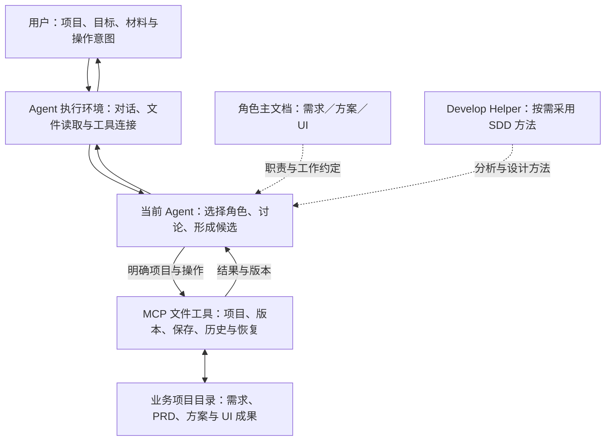

# SA-mate

以 SDD（规格驱动开发）为方法基础，让 Agent 按需求、方案和 UI 角色开展工作，通过 MCP 工具保存、校验和恢复项目成果。

用户可以只澄清需求、只讨论技术方案，或只制作 UI 演示。每次按目标选择角色，复用已有材料，完成后即可结束；需要工程实现时，再核对相关输入和后续条件。

**当前采用 Agent＋MCP 架构。** Agent 读取角色规则和适用方法，推进对话并形成候选；MCP 提供受控文件工具，负责项目核对、版本检查、保存、历史和恢复。当前阶段不建设独立工作流运行时、Runner 或常驻 Host。

> 发布范围（2026-11-03）：本仓库已收录 SDD 固定源码快照、中文阅读指南、当前架构说明和历史设计。三个角色的实现与测试目前保存在开发工作区，尚未随本次说明更新发布；克隆本仓库还不能直接启动三个角色的 MCP 服务。详见[当前状态](docs/current-status.md)。

## 当前架构

Agent 可以在当前对话中承担所选角色，无需每次新建子 Agent。MCP 是文件工具连接方式，不承担业务对话编排。角色规则、执行环境与模型分别说明；实际可用范围以对应环境验证为准。

[架构与职责](docs/architecture.md) · [使用与接入](docs/getting-started.md) · [当前状态](docs/current-status.md) · [近期路线](docs/roadmap.md)

## 三个独立角色

| 角色 | 主要工作 | 主要成果 | 当前实现位置（待发布） |
| --- | --- | --- | --- |
| 需求 | 澄清目标、按需调研，形成或修改需求与 PRD | `docs/requirements.md`、`docs/PRD.md` | `fusion-runtime/workflows/requirements/`；入口 `requirements.md` |
| 方案 | 根据本次用途讨论工程设计，形成七层技术方案 | `docs/tech-spec.md` | `fusion-runtime/workflows/Solution Designer/`；入口 `solution-design.md` |
| UI | 根据需求、方案、页面说明或参考制作独立演示 | `docs/ui-style.md`、演示页面及成果清单 | `fusion-runtime/workflows/UI/`；入口 `ui-design.md` |

已有材料足够时直接复用。UI 独立演示可从足够的页面或场景说明开始；工程方案保存仍核对其 PRD 和用途确认条件。保存成功、正式确认、成果登记、交接和下游启动分别判断。

方案与 UI 服务可以分别启动，但当前复用 requirements 的基础代码与配置。不要求需求 Agent 或需求 MCP 在线；仅复制某个角色目录仍不足以完整运行。

## 项目与成果

业务成果归明确的项目目录，三个角色围绕同一项目身份与文件协作。新对话通过实际读取成果、版本及相关记录继续；聊天摘要不替代项目文件。保存前核对读取版本，保留历史，结果未知时先复读。

**当前目录限制：** 本地工具虽然接收完整 `project_path`，仍要求项目位于配置的业务根目录下。按项目使用任意明确完整目录的能力待建设，尚不能按已支持功能使用。

## SDD 方法与来源

Develop Helper 提供需求 A、调研 R、方案与 UI 等方法、模板和工程协议。SA-mate 按本次角色和目标采用适用部分；不会因为读取方法而自动启动完整开发流程。

- [SDD 阅读入口](docs/sdd-foundation.md)：方法、目录与离线检查。
- [中文阅读指南](Develop_Helper_reading-guide/README.md)：理解原框架并定位原文。
- [上游来源](docs/upstream.md)：固定版本、快照范围与更新方式。
- [第三方来源说明](THIRD_PARTY_NOTICES.md)：来源及许可状态。

上游快照固定为 `ec75f8f113402be73a415282dd274a8e3513f291`，包含 169 个文件；另收录 8 篇中文指南。本次未修改这些文件。

## 历史设计

[历史设计索引](fusion-design/README.md)保留此前的融合架构、运行时与协作宿主研究及其证据范围。旧设计中的默认流程、架构选择和阶段停点按原日期理解；当前采用方式以本首页及 `docs/` 中的当前说明为准。

当前路线暂不采用 LangGraph，也不把 Buzz 作为三个角色的使用前提。本次保留历史资料，没有删除或改写历史验收结论。
