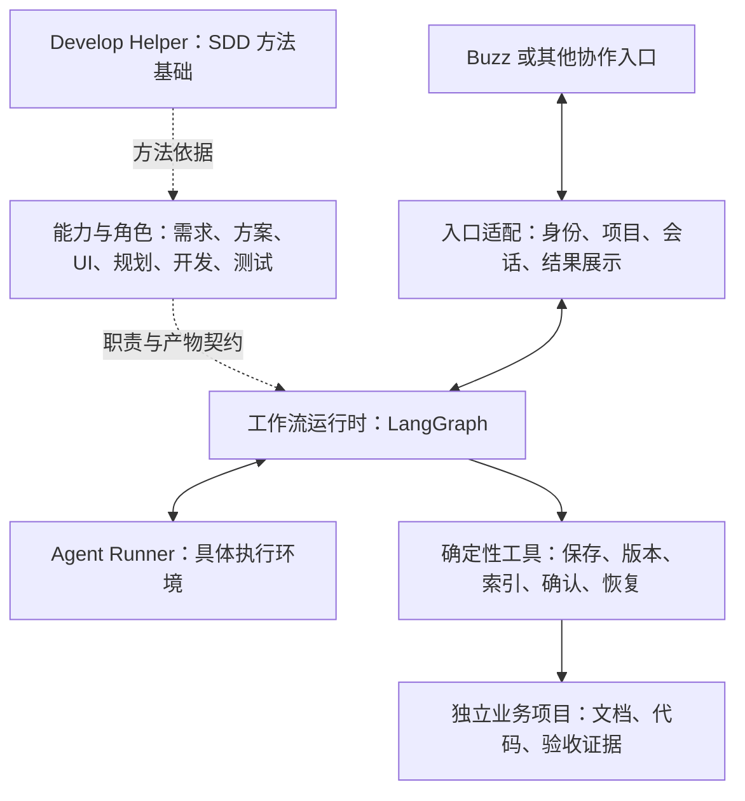

# SA-mate

> 当前仓库先发布架构首页，源码和详细资料正在整理；下文阅读路径将在对应资料上传后提供链接。

以 SDD 为方法基础，支持需求、方案和 UI 独立交付，并逐步衔接规划、开发与独立验收的智能体协作框架。

## High-level design



这张图展示各部分的职责关系。目标架构、已有实现、验证范围与生产接线分别说明，图中的角色和入口并非全部已经接通。

通用能力与确定性工具是独立的一块：角色形成候选内容，工具负责保存成果、校验版本、记录确认和事务恢复。

## 1. 底层 SDD：方法从哪里来

SA-mate 以 Develop Helper 的 SDD（规格驱动开发）方法为基础。原框架的主线为：

```text
目标
  → A：需求与验收（按需进入 R 调研，再返回 A）
  → 七层技术方案
  → 必要的 B：界面设计
  → Planner
  → Developer
  → Tester
  → 交付
```

| 内容 | 作用 |
| --- | --- |
| Skills | 每类工作怎样开展 |
| Agents | 执行角色的职责与边界 |
| Protocols | 调度、门禁、返工、恢复和交付 |
| Templates／Scripts | 形成成果、检查条件的辅助工具 |
| 可选规范／PyCore | 具体业务项目按需使用的工程资产 |

阅读指南负责帮助理解和定位；规则依据仍回到 `Develop_Helper/harness-core/` 原文。PyCore 是可选业务工程资产，工作流执行由独立 Runtime 承担。

阅读：Develop Helper（`Develop_Helper/README.md`，待上传） · 中文阅读指南（`Develop_Helper_reading-guide/README.md`，待上传）

## 2. 融合拆解：哪些保留，哪些改变

SA-mate 将原框架的方法按用途组织为两条路线：

- **独立交付**：只澄清需求、只输出方案、只制作 UI，都可以完成后结束。
- **工程衔接**：需要实现时，再补齐相关规格、确认、任务规划、开发和独立验收。

已有材料可以复用，后续工作只补必要缺口。用户未要求继续时，本次交付可以结束。

| 角色 | 核心责任 |
| --- | --- |
| Main | 理解意图、协调项目与角色、展示成果、收集决定 |
| 需求角色 | 澄清业务，形成需求或 PRD 候选 |
| Solution Designer | 形成方案与可追踪的技术契约 |
| UI 角色 | 页面、原型与演示验证 |
| Planner | 拆分 Feature、Task 和依赖 |
| Developer | 在明确范围内实现并自验 |
| Tester／Verifier | 独立验证并返回证据 |

Runtime 单独列为执行组件。角色生成候选与证据，Runtime 和确定性工具负责获授权的状态推进与权威写入。保存、登记、确认、交接、消息发送和下游启动分别判定。

**角色、执行环境、模型是三个维度。** 角色定义职责，执行环境提供会话和工具，模型负责推理与生成。Fizz／Honey 是本项目建设中使用的身份与分工，伙伴可以采用自己的名称和执行环境。

上述角色表描述职责方向；需求、方案、UI 和工程闭环的实际实现与接线程度分别判断。

阅读：拆解与融合框架（`fusion-design/00-拆解与融合框架.md`，待上传） · 设计索引与状态来源（`fusion-design/README.md`，待上传） · 能力与工具实现（`buzz-develop-helper/README.md`，待上传）

## 3. LangGraph：为什么需要，以及现在怎样跑

LangGraph 承担图执行、状态持久化、等待输入和暂停恢复。项目身份、角色权限、版本确认、幂等写入等规则，由 SA-mate 自己的代码负责。

工作流 checkpoint 保存执行状态，项目文件保存业务成果，确认记录保存准确版本与用途的批准依据。恢复时需要核对它们之间的关系，不能仅凭 checkpoint 存在判断业务成功。

### 两条已有图

**PRD 参考图**：

```text
固定项目 → 生成并保存 PRD → 登记 → 等待确认
  → 记录确认后停止
  → 显式续行 → 形成并保存技术方案 → 检查
```

**Main 入口图**：

```text
理解请求 → 缺信息时补问并等待
  → 冻结创建意图 → 初始化项目 → 核验结果
```

Main 入口图处理创建前的补问与项目初始化；创建项目不会自动启动 PRD 工作流。

### 已核对的运行基线

以下为 2026-10-20 核对时的阶段记录，各项保留自己的验收范围。首页发布不代表整套源码或生产服务已经交付。

- 已有文件 SQLite、恢复、领域工具和 Buzz 集成的分范围验证。
- Main 入口已有本地持久实现及临时测试。
- 启动入口仍注入测试 Runner／Tools。
- 尚无完整的自动入站推进服务循环，真实模型与新入口尚未整体接通。
- 现有记录中的生产默认仍为 ACP。

运行指南需分别说明“离线验证”“限定实验”“真实 Runner 接入”和“持续服务部署”。当前已有限定运行证据，完整生产业务仍需后续接线与验证。

阅读：角色与工作流运行时（`fusion-design/06-角色与工作流运行时.md`，待上传） · PRD 参考图实现（`fusion-runtime-lab/src/fusion_runtime/runtimes/langgraph_runtime.py`，待上传） · Main 入口图实现（`fusion-runtime-lab/src/fusion_runtime/runtimes/main_runtime.py`，待上传） · Main 实施计划（`fusion-runtime-lab/MAIN_RUNTIME_IMPLEMENTATION_PLAN.md`，待上传）

## 4. Buzz：协作宿主接入

Buzz 承担用户交互，以及身份、签名事件、频道、线程和消息发布。入口适配器将可信输入转换为中立事件，并把运行结果送回正确位置。

架构允许接入其他入口；具体工具需要完成相应适配，不能仅凭架构图认定已经可以直接替换。

| 贡献方向 | 要解决的问题 |
| --- | --- |
| 替换协作入口 | 为 Web、CLI 或其他消息平台建立可信身份、项目与会话关联、事件去重及结果展示 |
| 替换执行环境 | 通过 Runner 接入不同 Agent 工具，明确输入、候选结果、权限与失败行为 |

两个方向分别设计和验证。新的接入仍需维持准确版本与用途确认、角色工具边界，以及结果未知时不重复业务写入的恢复约束。

阅读：Buzz 接口勘察（`fusion-runtime-lab/PHASE5_BUZZ_INTERFACE_INVENTORY.md`，待上传） · Buzz 适配计划（`fusion-runtime-lab/PHASE6_BUZZ_ADAPTER_PLAN.md`，待上传）
