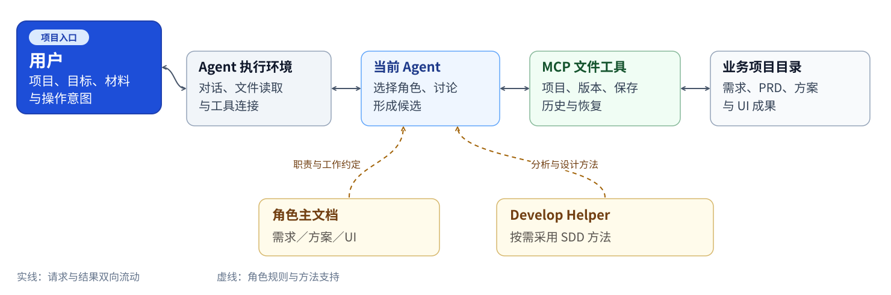

# 当前架构与职责

更新日期：2026-11-03。当前主线为 SDD 方法＋独立角色＋Agent＋MCP 文件工具＋项目成果。当前阶段不采用 LangGraph，不建设独立工作流运行时、Agent Runner、常驻 Host 或自动多角色调度。

左上方用户入口接收项目、目标、材料与操作意图；主流程从左向右展开，下方为角色规则和方法支持。

## 方法基础

Develop Helper 提供统一的入口规则、阶段方法、执行角色、协议、项目脚本与模板。SA-mate 按独立交付用途采用相关方法，并以 MCP 工具管理成果。原框架的分层、执行链和文件追踪见[Develop Helper 架构](develop-helper-architecture.md)；两者的项目元信息和推进方式在该文第 8 节分别说明。

## 一次工作的执行链

1. 用户提供本次目标、材料和项目位置，说明讨论、制作、保存或恢复意图。
2. Agent 读取所选角色主文档，按需读取 Develop Helper 方法与本地模板。
3. Agent 澄清关键缺口、分析材料、组织讨论并形成候选；已有选择直接继承。
4. 需要操作项目成果时，Agent 调用当前实际可用的 MCP 工具，明确传入项目路径和操作参数。
5. 工具核对项目、权限、读取版本及适用前置条件，执行确定性操作并返回实际结果。
6. Agent 根据工具结果说明完成范围、未决项和继续位置；不会因保存成功自动启动下游。

仅讨论无需先初始化项目。形成对话候选、保存 Draft、正式确认、登记和交接是不同动作。

## 组成与维护归属

| 组成 | 负责什么 | 当前承载 |
| --- | --- | --- |
| 用户 | 业务事实、目标、关键取舍与操作意图 | 当前对话 |
| Agent 执行环境 | 会话、模型调用、规则读取、执行与工具连接能力 | 按实际接入选择客户端；各环境分别验证 |
| 当前 Agent | 采用角色与方法、推进讨论、形成候选、调用工具并解释结果 | 当前对话即可承担角色 |
| 角色主文档 | 输入、方法采用、工作顺序、交付与停止规则 | 三个角色各自唯一主文档 |
| SDD 方法 | 需求、调研、工程方案与 UI 的分析方法 | Develop Helper 原文；按需读取 |
| MCP 文件工具 | 项目身份、受控读写、版本、历史、检查与恢复 | 各角色文件工具及共享基础 |
| 业务项目文件 | 持久保存需求、PRD、方案、UI 及相关记录 | 明确的项目目录 |

角色选择主要通过显式请求与主文档读取完成。工具发现中的入口提示不能证明 Agent 已读取规则或正确采用方法；统一自动路由未完成，不作为当前使用前提。

## 三个角色怎样协作

三个角色可以分别交付。需要复用成果时，读取同一项目中的实际文件及来源版本；不要求依次走完需求、方案和 UI，也不以对话中的角色自述替代工具检查。

- 需求负责轻量需求及完整 PRD，按需采用 A／R。
- 方案负责本次用途所需的设计与实现契约；工程保存仍要求满足当前 PRD 的用途确认条件。
- UI 负责可操作的独立演示、设计说明、打开方式和验证范围；独立演示可以从足够的场景材料开始。

保存、正式确认、登记、交接、消息发送和下游启动保持独立。当前独立环境的真实正式确认写入入口及完整衔接链仍有待补齐，不能用普通回复或测试夹具替代。

## 工具依赖与项目边界

当前源码位置为仓库中的 `fusion-runtime/workflows/`，该目录名沿用历史命名，不表示当前角色依赖独立工作流运行时。源码与隔离测试已发布，入口见[角色目录](../fusion-runtime/README.md)。

requirements 保存公共文件基础。方案和 UI 使用受控加载器复用其中九文件闭包及配置、锁定来源；它们不依赖需求服务在线，也不能仅复制自身目录独立分发。公共基础是否抽取及目录是否改名，后续单独实施。

每次调用明确项目路径，读取凭据与版本检查按项目隔离。当前仍有固定业务根目录及直接子目录约束；解除该约束的共享目录绑定改造列入近期计划，不能只删除服务入口校验。

项目文件、工具安装目录和上游方法分开管理。显式路径不增加宿主文件权限；方法来源变化按来源记录核对，不自动更新摘要接受漂移。UI 外部导入授权独立于项目目录选择。

## 状态与恢复

业务继续依赖实际项目文件、版本、历史及必要确认记录。新会话重新读取相关成果；进程内读取凭据失效时重新取得，不从聊天摘要重建已保存状态。

UI 的候选准备、检查、接受和恢复使用其文件工具协议。文件事务日志与历史解决具体保存过程的恢复，不代表已经建设通用工作流引擎。结果未知时先读取核对，避免盲目重试。

当前架构没有通用工作流 checkpoint、服务端角色调度或默认后台推进循环。历史研究保存在[历史设计](../fusion-design/README.md)，不进入当前安装依赖和近期建设任务。

返回[首页](../README.md) · [当前状态](current-status.md) · [近期路线](roadmap.md)
