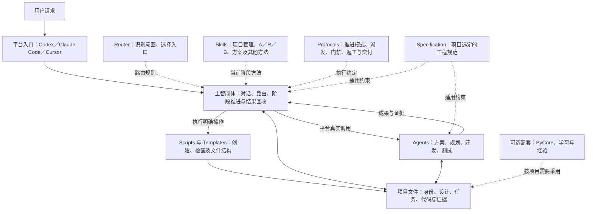
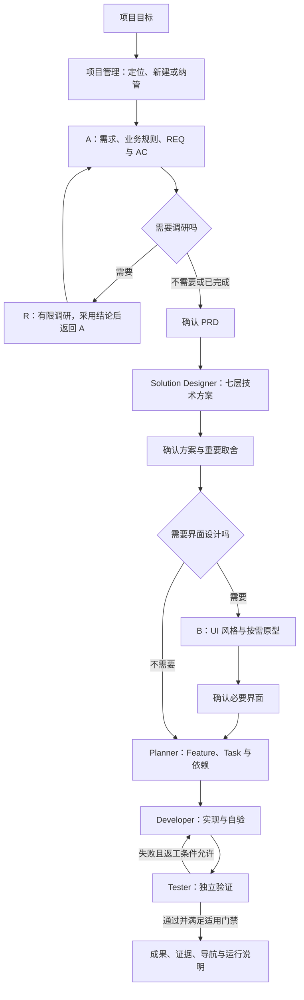

# Develop Helper 架构

更新日期：2026-11-03。本页根据仓库已收录的 Develop Helper / SDD V7_2 固定快照整理，源码版本为 `ec75f8f113402be73a415282dd274a8e3513f291`。本页是架构导读；具体工作规则回到原文，不修改上游源码，也不新增运行组件。

Develop Helper 是多项目开发工作台：通过统一规则组织需求、设计、规划、开发与验收，由当前平台的主智能体读取规则、调用角色和脚本，并将项目事实保存到文件。

[原始 README](../Develop_Helper/README.md) · [整体阅读指南](../Develop_Helper_reading-guide/01-overview.md) · [SA-mate 当前架构](architecture.md)

## 1. 架构全貌

图中的 Router、Skills 和 Protocols 主要是 Agent 读取的规则文件。实际执行由当前客户端和 Agent 工具承担；读取角色配置、脚本返回候选或文件状态改变，分别需要对应的执行事实。

## 2. 六类组成

| 组成 | 位置 | 作用 |
| --- | --- | --- |
| 平台入口与薄适配 | `AGENTS.md`、`.agents/`、`.codex/`、`.claude/`、`.cursor/` | 引导不同平台读取同一核心规则，提供角色和方法入口 |
| 核心流程与角色 | `harness-core/router.md`、`skills/`、`agents/`、`protocols/` | 定义意图分流、阶段方法、职责与继续条件 |
| 可选工程规范 | `harness-core/specification/` | 约束选定技术栈的代码、接口、配置和测试 |
| 项目事实与成果 | `project-registry.json`、`Projects_Repo/<project-id>/` | 保存项目身份、规格、任务、代码和验证证据 |
| 确定性工具与模板 | `scripts/`、`templates/` | 创建或管理项目、检查一致性和派发条件、提供文件结构 |
| 配套能力 | `pycore/`、`learning/`、`memory/` | 按需复用业务基础库、术语学习和经验 |

业务项目目录保存自己的代码、`docs/` 与 `.sdd/`；核心规则和平台适配保留在框架目录。任务只读取当前阶段和范围需要的材料。

## 3. 平台怎样进入同一核心

| 平台 | 路由入口 | 角色适配 |
| --- | --- | --- |
| Codex | [AGENTS.md](../Develop_Helper/AGENTS.md) | [.codex/agents](../Develop_Helper/.codex/agents/) |
| Claude Code | [.claude/CLAUDE.md](../Develop_Helper/.claude/CLAUDE.md) | [.claude/agents](../Develop_Helper/.claude/agents/) |
| Cursor | [.cursor/rules/00-harness-router.mdc](../Develop_Helper/.cursor/rules/00-harness-router.mdc) | [.cursor/agents](../Develop_Helper/.cursor/agents/) |

入口统一指向 [Router](../Develop_Helper/harness-core/router.md)。角色适配指向 `harness-core/agents/`，阶段方法指向 `harness-core/skills/`，避免各平台独立维护完整流程副本。

是否能启动相应角色，以当前平台实际能力与调用结果为准。原框架对首次方案和规划有实际派发要求；只有平台能力不可用时，才按[子智能体协议](../Develop_Helper/harness-core/protocols/codex-subagents.md)明确降级。这是 Develop Helper 原框架的执行约定；SA-mate 的独立角色采用方式见第 8 节。

## 4. 从目标到交付

此图概括新项目主线。已有项目修改从受影响阶段继续；R 是按需调研分支，B 仅在需要界面时进入。并行关系由真实任务依赖、推进模式、资源和写入范围决定。

[产品设计入口](../Develop_Helper/harness-core/skills/sdd-product-design/SKILL.md) · [方案方法](../Develop_Helper/harness-core/skills/solution-design/SKILL.md) · [开发循环](../Develop_Helper/harness-core/protocols/development-loop.md)

## 5. 主智能体与四种执行角色

| 角色 | 主要职责 | 结果与边界 |
| --- | --- | --- |
| 主智能体 | 与用户对齐、定位项目、组装上下文、派发、回收结果和推进阶段 | 维护任务执行状态；按模式、门禁及实际资源决定后续工作 |
| Solution Designer | 将已确认需求形成七层技术方案及重要决策 | 输出方案与待决项；不拆任务或写业务代码 |
| Planner | 将设计转成 Feature、Task、依赖和验收安排 | 首次生成任务计划；已执行计划的调整交主智能体应用 |
| Developer | 在指定任务和写入范围内实现与自验 | 返回改动、自验证据和未验项 |
| Tester | 对指定基线独立验证必要 AC 与技术检查 | 返回 PASS／FAIL／BLOCKED 与证据；不改业务实现或任务状态 |

原框架的 A／R 属于产品设计方法，B 调用 UI 设计方法；它们不等于另外定义了三个必须常驻的子智能体。角色原文见[核心角色目录](../Develop_Helper/harness-core/agents/)。

## 6. 文件怎样连接需求、实现与证据

以下 `docs/` 和 `.sdd/` 路径均相对具体业务项目。

| 文件 | 保存的事实 |
| --- | --- |
| 框架根 `project-registry.json` | 项目登记与默认活动项目 |
| `.sdd/project.json` | 项目身份、类型及规范集选择 |
| `docs/PRD.md` | 用户目标、需求、业务规则和 REQ／AC |
| `docs/tech-spec.md` | 技术设计、接口、数据、算法与异常处理 |
| `docs/decisions.md` | 有实质取舍时记录选项、影响与确认依据 |
| `docs/ui-style.md`、`docs/prototypes/` | 必要界面风格与按需原型 |
| `.sdd/tasks.json` | Feature、任务、依赖、执行状态与门禁 |
| `.sdd/work-log.md`、按需测试报告 | 关键进展、阻塞、确认和较长证据 |
| 项目 `README.md`、`docs/project-console.html` | 配置、启动、验证、功能导航与交付入口 |

追踪关系为：**用户目标 → REQ／AC → 技术设计／API → 必要 UI → Feature → Task → 验证证据**。

`tasks.json` 是任务执行状态的权威来源；初始化的 `.sdd/status.json` 不能代替它。`in_progress` 也不能证明相应角色仍在运行，恢复时还要核对实际调用、文件与验证基线。详见[角色、文件与追踪关系](../Develop_Helper_reading-guide/03-roles-and-artifacts.md)。

## 7. 脚本、门禁与可选基础库

[项目脚本](../Develop_Helper/scripts/sdd_project.py)负责项目创建及管理操作；[派发检查](../Develop_Helper/scripts/sdd_dispatch.py)根据任务文件检查候选和已实现的条件；[一致性检查](../Develop_Helper/scripts/check_harness_consistency.py)核对框架引用、模板和部分契约。

主智能体取得派发候选后，还需核对实际运行角色、名额、冲突及适用授权，再调用平台工具。派发脚本本身不启动角色、不更新任务，也不代替对全部验收语义的判断。

`automatic` 与 `step_by_step` 决定推进节奏；前端 Mock 用户门禁、必要配置和独立验收仍按协议执行。具体规则见[推进模式](../Develop_Helper/harness-core/protocols/execution-mode.md)、[前端门禁](../Develop_Helper/harness-core/protocols/frontend-gate.md)与[调度指南](../Develop_Helper_reading-guide/04-execution-and-gates.md)。

规范集由用户明确选择：`default`、自定义集合或 `null`。字段缺失表示尚未选择，不自动采用默认值。PyCore 是可选业务程序基础库，其中 Flow、Service 和 AgentService 服务于已开发软件的运行，不承担这套开发工作台的角色派发。详见[规范说明](../Develop_Helper/harness-core/specification/README.md)与[PyCore 文档](../Develop_Helper/pycore/docs/index.md)。

## 8. SA-mate 怎样复用 Develop Helper

| 方面 | Develop Helper 固定快照 | SA-mate 当前采用方式 |
| --- | --- | --- |
| 工作入口 | 平台入口 → Router → 对应方法和项目流程 | 显式选择需求、方案或 UI 角色，读取其唯一主文档 |
| 方法 | A／R、七层方案、B、规划与开发协议 | 按本次用途采用适用部分，保留方法来源 |
| 推进 | 主智能体组织阶段与执行角色 | 当前 Agent 可以完成独立角色交付，完成后结束 |
| 文件操作 | 上游脚本、项目文件和执行协议 | 各角色 MCP 工具负责受控读取、保存、版本、历史与恢复 |
| 项目元信息 | `.sdd/project.json` 与框架登记表 | 项目根 `project.json`，沿用当前工具的项目身份规则 |
| 当前交付重点 | 从规格到工程实现、独立验证与交付 | 需求、方案、UI 独立使用，按明确目标衔接后续成果 |

Develop Helper 的文件驱动开发工作台不要求 LangGraph。SA-mate 当前也不采用 LangGraph；发布上游架构不会恢复已移出的独立运行时、Runner 或常驻 Host 路线。

本次发布提供架构导读和源码导航。上游固定快照与 8 篇阅读指南保持不变，三个 SA-mate 角色的 MCP 源码与隔离测试已另批发布，入口见[角色目录](../fusion-runtime/README.md)。来源版本和许可状态见[上游说明](upstream.md)；本页采用文件及摘要见[本次发布记录](../upstream/develop-helper-architecture-publication.json)。

返回[SA-mate 首页](../README.md) · [SDD 阅读入口](sdd-foundation.md)
