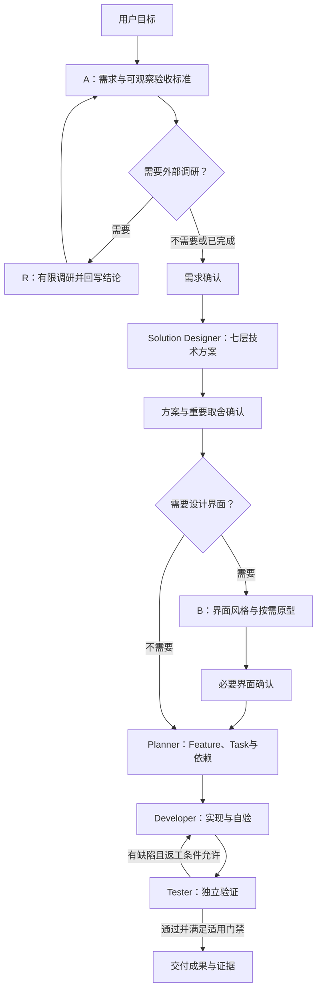

# 底层 SDD：方法、目录与阅读入口

SDD（规格驱动开发）将用户目标逐步落实为需求、实现方案、任务与验收证据。SA-mate 的方法基础来自 Develop Helper，本板块先提供固定版本的原框架与中文阅读指南。

## 从哪里开始

| 目的 | 阅读入口 |
| --- | --- |
| 先看整体流程 | [阅读指南](../Develop_Helper_reading-guide/README.md) → [整体架构](../Develop_Helper_reading-guide/01-overview.md) |
| 理解从需求到交付 | [新项目流程](../Develop_Helper_reading-guide/02-new-project.md) → [完整实例](../Develop_Helper_reading-guide/06-walkthrough.md) |
| 查角色和成果归属 | [角色与文件](../Develop_Helper_reading-guide/03-roles-and-artifacts.md) |
| 查暂停、确认、返工和恢复 | [调度与门禁](../Develop_Helper_reading-guide/04-execution-and-gates.md) → [已有项目与恢复](../Develop_Helper_reading-guide/05-existing-projects.md) |
| 核对权威规则及已知差异 | [原文地图](../Develop_Helper_reading-guide/07-source-map-and-notes.md) → [核心规则目录](../Develop_Helper/harness-core/) |
| 核对来源版本与收录范围 | [上游说明](upstream.md) |

阅读指南帮助理解和定位；规则依据回到 `harness-core/` 原文。原文与历史说明中的示例、阶段记录和命令，均按所在语境使用，不自动成为 SA-mate 的运行授权。

## 方法主链



这张图概括上游方法。具体推进模式、依赖、前端门禁和授权以原文协议为准；SA-mate 对独立交付与 Runtime 的适配另属后续板块。

追踪关系为：`用户结果 → REQ → AC → 技术设计/API → UI → Feature → Task → 独立证据`。

## 当前发布的目录

```text
SA-mate/
├── README.md
├── Develop_Helper/                   # 固定提交的上游源码快照
│   ├── README.md
│   ├── AGENTS.md                     # 该子目录的原始 AI 入口
│   ├── harness-core/
│   │   ├── router.md                 # 按请求意图选择入口
│   │   ├── skills/                   # 产品设计、方案、项目管理等方法
│   │   ├── agents/                   # 四种上游执行角色
│   │   ├── protocols/                # 调度、推进、门禁、恢复与交付
│   │   └── specification/            # 按项目选择的工程规范
│   ├── .agents/ .codex/ .claude/ .cursor/ # 平台发现与角色薄适配
│   ├── scripts/                      # 项目管理、派发检查、一致性检查及测试
│   ├── templates/                    # 项目、任务和记录模板
│   ├── pycore/                       # 可选 Python 业务基础库及说明
│   ├── project-registry.json         # 空白初始登记；无个人项目
│   ├── Projects_Repo/.gitkeep         # 空业务项目容器
│   ├── learning/                     # 上游空白学习记录
│   └── memory/                       # 上游经验；历史参考按原文标识理解
├── Develop_Helper_reading-guide/     # 8 篇导航与解释，和上游并列
├── docs/
│   ├── sdd-foundation.md              # 本页
│   └── upstream.md                    # 版本、来源、范围与更新方式
├── upstream/
│   └── develop-helper-source.json     # 固定版本和逐文件校验清单
└── THIRD_PARTY_NOTICES.md              # 来源及许可状态说明
```

两个主要目录保持并列，因此指南中的 `../Develop_Helper/...` 链接可以直接访问原文。新增说明放在 `docs/`，来源清单放在 `upstream/`，不改写上游角色规则或模板。

## 原框架里哪些内容负责什么

| 内容 | 职责 |
| --- | --- |
| Skills | 定义本类工作的方法、输入和输出；A/R/B 分别对应需求、按需调研和界面设计 |
| Agents | Solution Designer 形成实现方案；Planner 拆任务；Developer 实现与自验；Tester 独立验证 |
| Protocols | 定义推进节奏、派发与回收、门禁、有限返工、恢复和交付 |
| Scripts | 创建或管理项目、计算可派发条件、检查部分契约；脚本检查通过不代表 Agent 已启动或业务已通过 |
| Templates | 提供成果与记录结构；示例字段不替代真实项目决定 |
| Specification | 按项目明确选择规范集；`null` 表示不加载规范集 |
| PyCore | 可选业务程序基础库；其依赖与工作流 Runtime 分开理解 |

上游由主会话承担产品沟通与编排，定义四种执行角色。融合层的独立需求角色、UI 角色和独立 Runtime 另有适配设计，不能从上游文件存在推断它们已经全部接通。

## 先做离线检查

在 SA-mate 根目录，用 Python 3.11 或以上执行：

```sh
python3 -B Develop_Helper/scripts/check_harness_consistency.py
PYTHONDONTWRITEBYTECODE=1 python3 -B -m unittest discover -s Develop_Helper/scripts/tests -p 'test_sdd_*.py' -v
PYTHONDONTWRITEBYTECODE=1 python3 -B -m unittest discover -s Develop_Helper/scripts/tests -p 'test_harness_consistency.py' -v
```

这些检查面向框架引用、模板和脚本行为，测试使用临时目录。它们不调用真实模型，不验证业务成果，也不启动 SA-mate 的 LangGraph 服务。

`test_pycore_config.py` 还需要环境具备相应 PyCore 依赖。本次尝试完整测试发现时，该测试模块因环境缺少 `loguru` 无法导入，未完成验证；未安装依赖或修改上游。PyCore 的依赖入口见 [包声明](../Develop_Helper/pyproject.toml)，已有声明与实际导入的差异另见[原文地图](../Develop_Helper_reading-guide/07-source-map-and-notes.md)。不要为阅读 SDD 方法而先安装整套业务运行依赖。

本批发布前验证：框架一致性检查通过；项目／调度测试 49 项与一致性测试 19 项通过；314 个本地 Markdown 链接均可定位。上游 169 个文件及指南 8 个文件的字节摘要与来源清单一致。上述结果不包含未能加载的 PyCore 配置测试组，也不构成业务验收。

若要独立使用原框架，可从 [上游 README](../Develop_Helper/README.md) 和 [项目管理方法](../Develop_Helper/harness-core/skills/project-management/SKILL.md) 了解入口。项目创建和其他写入按具体任务意图执行；运行离线检查不会要求创建真实业务项目。

## 本批发布边界

- 原框架固定到 `ec75f8f113402be73a415282dd274a8e3513f291`，169 个已提交文件逐字节保留。
- 中文阅读指南收录本地提供的 8 篇 Markdown，正文保持原样。
- 不带入本机未提交的项目登记和学习进度，也不带入真实业务项目、Git 内部数据、依赖、缓存或凭据。
- 原框架中的历史说明保留原意；例如打包说明与后续流程的差异，已在阅读指南的原文地图中说明。
- 本批未发布融合实现、LangGraph Runtime 或 Buzz 源码；首页其他板块继续标明待上传路径。

返回 [SA-mate 首页](../README.md)。
