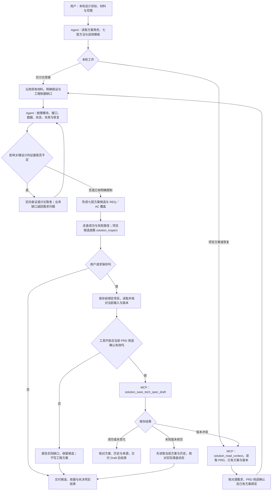

# 方案角色与 MCP 文件工具

发布版：2026-11-03。唯一角色入口为 [solution-design.md](solution-design.md)，文件操作按[约定](agent-file-workflow.md)。Agent 按用途组织工程设计，工具提供 `solution_read_context`、`solution_inspect`，追加 `--allow-save` 后开放 `solution_save_tech_spec_draft`。

## 角色流程

工程保存要求当前 PRD 的准确版本具有“形成技术方案”的有效正式用途确认，并满足其他工具前置条件。确认缺失不阻止只读讨论或候选检查；普通对话同意和结构检查不能替代正式确认。角色不自动启动 UI、规划或开发。

先按[接入说明](../../../docs/getting-started.md)准备共享 requirements 配置。服务入口为 `mcp_server.py`，启动时提供 requirements 的绝对 `--foundation`；不要求需求服务在线，也不依赖旧 helper 运行代码。必须保留本目录、requirements 共享基础及 Develop Helper 方法来源。

工程保存核对当前 PRD 的结构、来源、有效用途确认和读取版本；缺少正式确认时停止。保存保留历史并复读，只产生 Draft，不登记、不签发确认或启动下游。独立环境的受信确认写入入口和真实业务完整链仍有待补齐。

[工具契约](solution-tools-implementation-plan.md)与[测试清单](solution-tools-test-checklist.md)保留具体约束。来源与本地文档基线见 [SOURCES.json](SOURCES.json)。源码和模板变化需审查对应记录，不运行时自动刷新。

从仓库根目录运行 `python3 -B -m unittest discover -s fusion-runtime/tests -p 'test_solution_*.py'`。隔离项目验证包含文件保护、冲突、历史与 stdio 服务；不替代真实客户端或业务验收。
