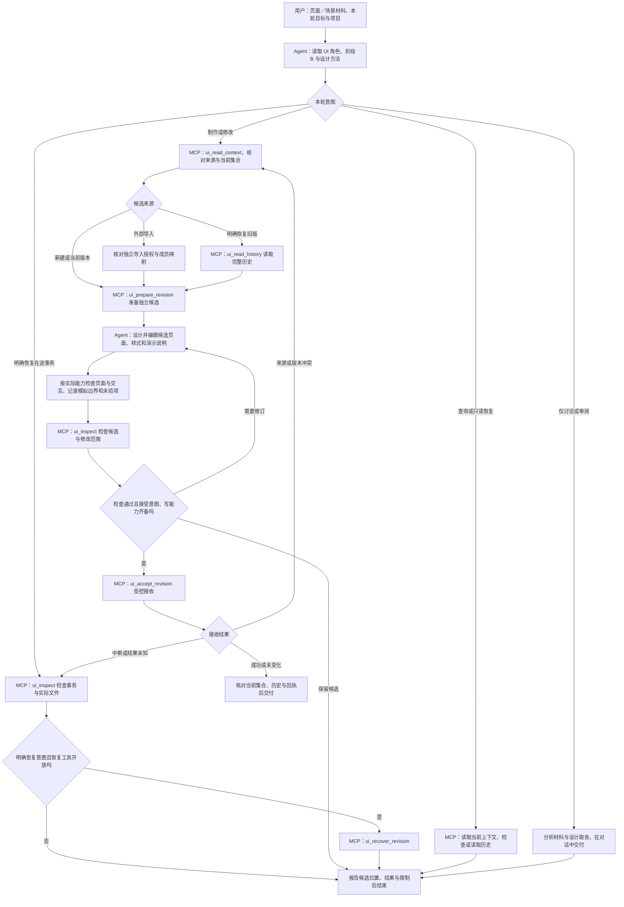

# UI 角色与 MCP 文件工具

发布版：2026-11-03。唯一角色入口为 [ui-design.md](ui-design.md)，文件操作按[约定](agent-file-workflow.md)。Agent 根据需求、方案、页面说明或参考制作独立演示。

## 角色流程

准备候选、受控接收和事务恢复需要对应写能力。检查在途事务后，只有存在明确恢复意图时才调用恢复工具，否则报告实际状态；不盲目重复接收。恢复旧版会形成新候选并保留中间历史。仅讨论不制作页面，工具未连接时不覆盖已有基线。文件接收成功与浏览器、视觉、业务验收分别说明。

服务入口为 `mcp_server.py`，共享 requirements 配置；先按[接入说明](../../../docs/getting-started.md)核对来源。只读提供 `ui_read_context`、`ui_inspect`、`ui_read_history`；`--allow-write` 另开放 `ui_prepare_revision`、`ui_accept_revision`、`ui_recover_revision`。

当前项目读取后准备候选，在候选树内编辑，经检查再受控接收。保留不可变集合历史、事务回执和显式恢复；文件保存成功不代表浏览器、视觉、业务认可或正式确认。外部导入需要独立的 `--import-root` 授权。

工具每次明确项目，当前仍受固定业务根目录约束。UI 不登记成果、不签发正式确认、不部署，也不自动修改 PRD 或技术方案。服务可独立启动，但需要 requirements 的共享基础和上游方法，不要求需求或方案服务在线。

[工具契约](ui-tools-implementation-plan.md)与[测试清单](ui-tools-test-checklist.md)规定具体边界；[SOURCES.json](SOURCES.json)核对受控运行源码、共享基础和适用文档。完整故障矩阵与真实客户端、浏览器及业务验证仍有后补范围。

从仓库根目录运行 `python3 -B -m unittest discover -s fusion-runtime/tests -p 'test_ui_*.py'`。测试在临时项目进行，不改写已有业务成果。
