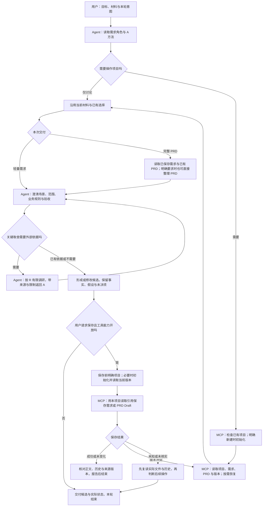

# 需求角色与 MCP 文件工具

发布版：2026-11-03。唯一角色入口为 [requirements.md](requirements.md)，文件操作按[约定](agent-file-workflow.md)。Agent 读取 A／R 方法组织讨论，MCP 负责项目检查、初始化、需求与 PRD 读写、补录、历史和恢复。原程序 Workflow 已退役，不在本次源码发布范围内。

## 角色流程

轻量需求与 PRD 分别保存；需求变化时先按请求同步需求，再读取新版并更新 PRD。两次保存不承诺原子同步。保存不签发正式确认，也不自动进入方案角色；仅讨论不初始化项目。工具未开放时交付候选并说明缺口。

先按[接入说明](../../../docs/getting-started.md)生成本机配置并检查来源。入口 `cursor_mcp.py` 默认只读；`--allow-initialize` 开放初始化，`--allow-save` 开放需求／PRD 保存及项目选择补录。每次传入完整 `project_path`，当前仍限配置业务根目录的直接子目录。读取引用在对应项目内使用，进程重启后重新读取。

普通保存沿用版本冲突、历史和写后复读；未知结果先读取核对。需求保存、PRD 保存、正式确认、登记和下游启动分别处理。正式确认校验使用本地只读闭包，不提供确认签发入口。

文件工具位于 `file_tools/`，来源见 [SOURCES.json](file_tools/SOURCES.json)。方案与 UI 共用这里的九文件基础、配置与来源锁，不要求本需求 MCP 在线。

## 测试与历史迁移

从仓库根目录运行 `python3 -B -m unittest discover -s fusion-runtime/tests -p 'test_requirements_*.py'`。测试使用临时项目，隔离夹具确认不是真实用户确认。

已有安装的可选迁移辅助仍保留 `--prepare-local-config-from buzz-develop-helper` 和 `--migrate-from-foundation buzz-develop-helper`，分别处理本地配置复制和准确旧 Cursor 条目迁移。新安装不依赖旧目录，按接入说明直接生成自己的本机配置。辅助程序默认预览，应用需使用预览返回的准确命令。

本次发布锁适配仓库中的固定上游快照，排除个人项目登记与学习状态；来源变化见[发布记录](../../../upstream/independent-roles-publication.json)。当前发布不迁移本机业务项目或客户端配置。
