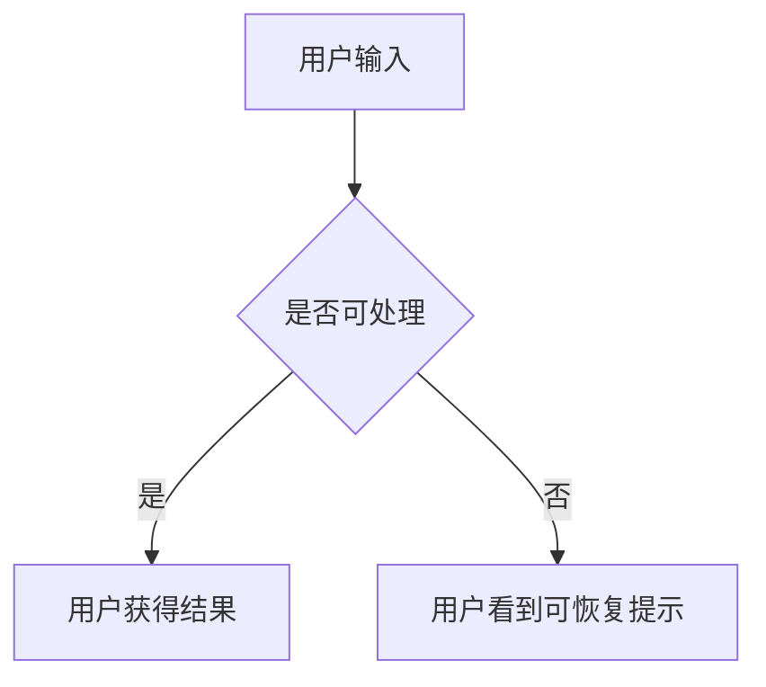
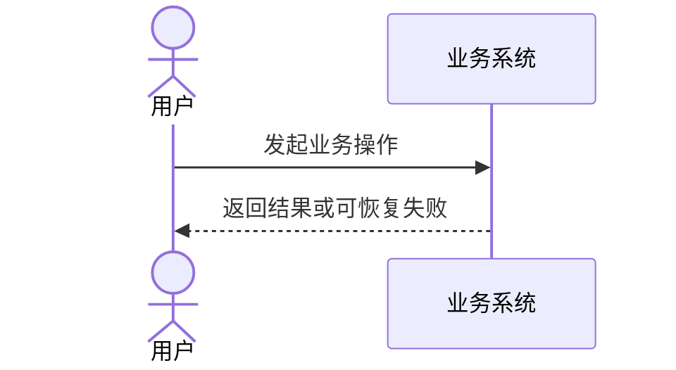

# PRD 模板（A 阶段工程基线）

> 保存工具会生成 `artifact_kind: prd`、`status: Draft`、`approval_verified: false` 和输入摘要；正文不要自带 front matter。

## 用户结果与成功指标

- 使用者：
- 使用场景：
- 当前做法与成本：
- 期望结果：
- 为什么现在做：
- 成功指标：
- 优先级及依据：

## 具体案例

`用户输入 → 系统处理 → 用户结果 → 失败后怎么办`

## 范围与边界

### 本次范围

### 明确不做

### 以后再做

### 外部前置条件

## REQ 与 AC

## REQ-001 能力名称

- 用户结果：
- 业务规则：
- 优先级：

### AC-001 成功结果

- 结果类型：成功
- 前置条件：
- 操作：
- 可观察结果：
- 验证方式：

### AC-002 关键失败结果

- 结果类型：失败
- 前置条件：
- 操作：
- 可观察结果：
- 验证方式：

## 业务流程图

## 业务时序图

## 事实、假设与待决事项

### 项目事实

### 外部事实与来源

### 假设

### 待决事项

### 暂不影响当前用途

## 变更摘要

- 本版变更：
- 变更原因：
- 受影响的 REQ/AC：
